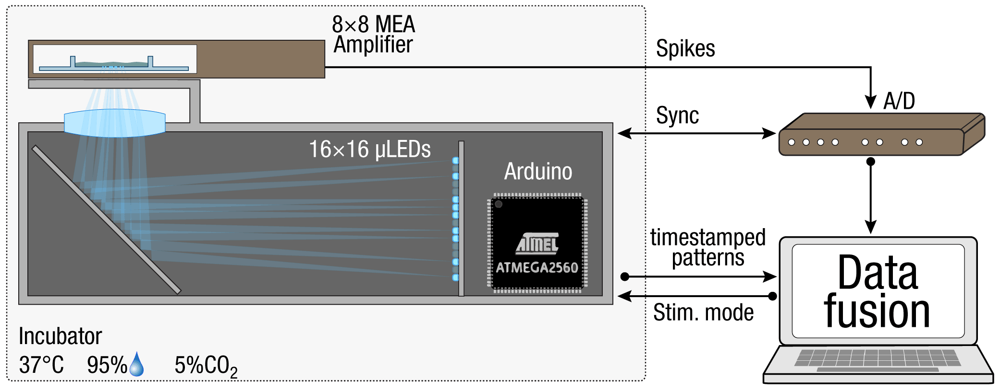
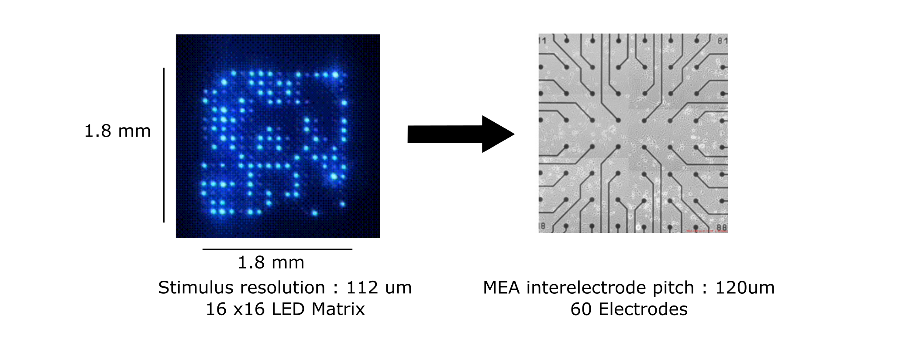
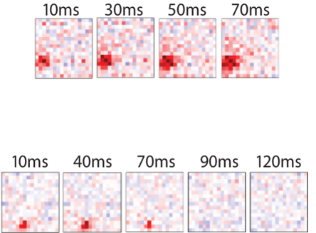
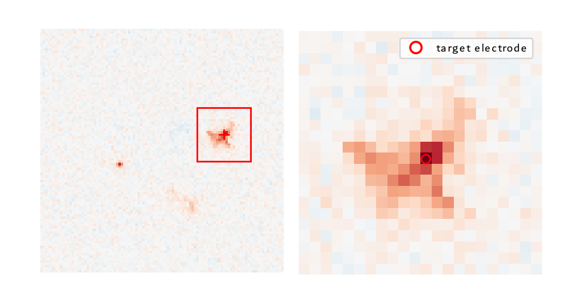

## Pre-existing chronic light perturbation experiments

::: {.columns}

::: {.column width="60%"}

  

  

LightDisco Ver 1.0
:::

::: {.column width="40%"}

::: {.fragment .fade-in}
{width="100%" .fade-in-then-out data-fragment-index="2"}
Receptive Field estimates
:::
:::

:::

Dr. Andreas Neef

## Communication between neurons

::: {.columns}

::: {.column width="50%"}
#### Action potential
{.fragment .fade-in data-fragment-index="1" width="100%"}
In vivo recording of an anesthetized rat *
:::

::: {.column width="50%"}
#### represented as spike times
{.fragment .fade-in data-fragment-index="2" width="100%"}

:::

:::

Nawrot MP et al. 2007

{width="100%"}

$$
\text{Scaling factor}=\frac{17.5}{19.0}=0.92
$$

